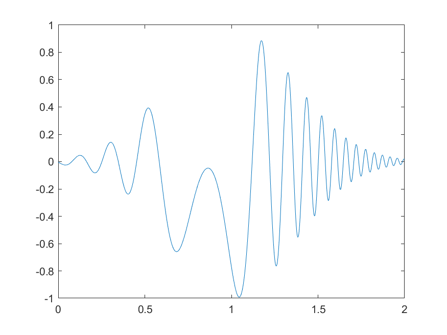
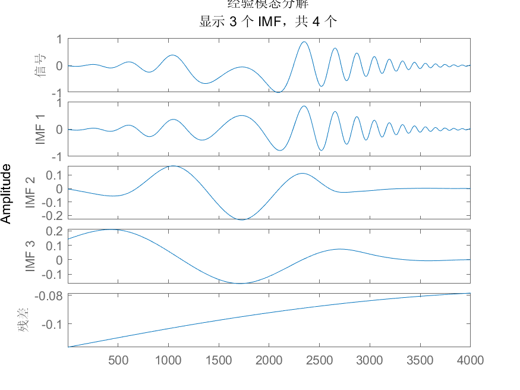
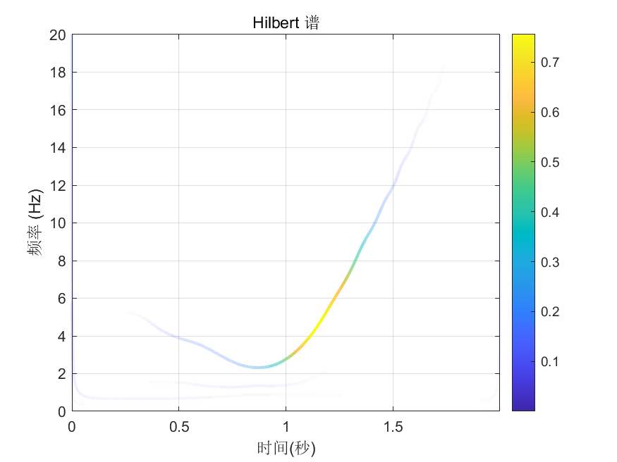

# MATLAB | Spectrum Analysis Algorithm | Hilbert Huang Transform | Includes data and plotting code | Directly Useable

1. Basic Definition of Hilbert-Huang Transform (HHT)
The Hilbert-Huang Transform is a signal analysis method based on the Empirical Mode Decomposition (EMD). It decomposes a signal into several Intrinsic Mode Functions (IMF) and a residue term, then uses the Hilbert transform to perform frequency analysis on each IMF, resulting in the signal's representation in both time-frequency domains. The Hilbert-Huang Transform can be used for analyzing nonlinear and non-stationary signals, such as seismic waves and biosignals. The steps of the Hilbert-Huang Transform are as follows:
Perform the Empirical Mode Decomposition on the original signal, breaking it down into several Intrinsic Mode Functions (IMF) and a residue term, ensuring that each IMF has different vibrational patterns and shares similar characteristics with the Hilbert transform.
Apply the Hilbert transform to each IMF to obtain its analytical signal.
Calculate the instantaneous frequency and amplitude of each analytical signal to obtain the signal's representation in both time-frequency domains.
Sum up the time-frequency domain expressions of each IMF to obtain the original signal's time-frequency domain representation.
The advantage of the Hilbert-Huang Transform is that it can analyze nonlinear and non-stationary signals without requiring predefined models, while also extracting time-frequency domain features of the signal. However, this method has a high computational cost, requires performing the Hilbert transform on each IMF, and has a higher complexity in computation. Additionally, it may result in significant errors for some short signals.
2. Definition and Outline Effects
The following outline effects are attached:
\n        \n          \n          \n          \n          \n            To view this video please enable JavaScript, and consider upgrading to a\n            web browser that\n            supports HTML5 video\n  

## Images

<!-- PAYMENT_BLOCK -->

## Get this dataset

- Payment link (Stripe): [Buy now](https://buy.stripe.com/3cs8yP7sY87d0vu9AB)
- Payment QR code: 

<!-- /PAYMENT_BLOCK -->
